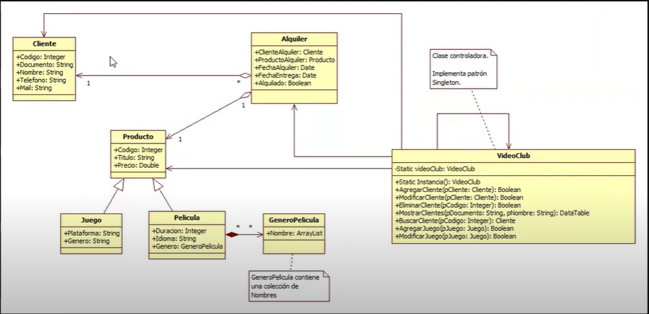

# VideoClub API — Java 17 + Spring Boot 3

Proyecto de aprendizaje basado en el [UML original](images/uml.png). Actualmente implementa **las siete operaciones del controlador del diagrama** mediante Spring MVC, servicios y repositorios JPA, con MySQL para desarrollo y H2 para pruebas.

> **Importante:** el [UML avanzado v2](docs/uml-v2-proposal.md) y las tareas del [roadmap](ROADMAP.md) son una **propuesta futura**. Todavía no contamos con un sistema completo de alquileres, devoluciones o pagos.

## Relación con otros repositorios

- [VideoClub Java + Spring Boot](https://github.com/samantonio91/videoclub-api-java): JPA, arquitectura en capas, pruebas y, posteriormente, transacciones y concurrencia.
- [VideoClub Express + TypeScript](https://github.com/samantonio91/videoclub-api-express-ts): composición manual de capas y validación HTTP.
- [VideoClub NestJS + TypeScript](https://github.com/samantonio91/videoclub-api-nestjs-ts): módulos e inyección de dependencias.

Son **variaciones educativas del mismo dominio**, no tres productos comerciales.

## Modelo actualmente implementado

- `Cliente`: identificador, documento, nombre, teléfono y correo.
- `Producto`: código, título y precio; superclase JPA.
- `Juego` y `Pelicula`: herencia JPA `JOINED` de `Producto`.
- `Alquiler`: referencias a cliente/producto, fechas y estado; **no existe todavía el flujo completo de préstamo/devolución**.
- `GeneroPelicula` del UML original sigue pendiente; los servicios son administrados por Spring en lugar de un singleton estático manual.

## API actual

| Método UML | HTTP | Ruta |
| --- | --- | --- |
| AgregarCliente | POST | `/api/clientes` |
| ModificarCliente | PUT | `/api/clientes/{codigo}` |
| EliminarCliente | DELETE | `/api/clientes/{codigo}` |
| MostrarClientes | GET | `/api/clientes?documento=ABC&nombre=Ana` |
| BuscarCliente | GET | `/api/clientes/{codigo}` |
| AgregarJuego | POST | `/api/juegos` |
| ModificarJuego | PUT | `/api/juegos/{codigo}` |

Se mantienen las rutas antiguas `POST /api/save-cliente` y `GET /api/get-client?cliente_id=1`. Los IDs de las rutas son los identificadores JPA (`Long`), diferentes del código de negocio de producto. La API utiliza 400 para entradas inválidas, 404 si no existe el recurso y 409 ante conflictos de borrado con alquileres.

## Desarrollo local

Requisitos: Java 17 y MySQL. El proyecto incluye Gradle Wrapper.

1. Crear una base de datos local llamada `videoclub`.
2. Establecer `DB_USERNAME` y `DB_PASSWORD` en el entorno de desarrollo.
3. Iniciar con `./gradlew bootRun` (Windows: `gradlew.bat bootRun`).
4. Ejecutar `./gradlew test`; las pruebas utilizan H2 y no requieren MySQL.

**Advertencia de migraciones:** los cambios de herencia y fechas afectan al esquema existente. Evita ejecutar `ddl-auto=update` sobre datos importantes; el [issue #5](https://github.com/samantonio91/videoclub-api-java/issues/5) incorpora Flyway.

## Pruebas disponibles

- Pruebas de servicios para operaciones de clientes y juegos.
- Integración JPA de herencia y filtrado.
- GitHub Actions con Gradle.

## Siguiente etapa

Consulta [ROADMAP.md](ROADMAP.md) para ver issues de mejoras: validaciones, migraciones, inventario, alquiler y devolución transaccional, reservas, seguridad, pruebas con Testcontainers, OpenAPI y observabilidad.

El [nuevo UML propuesto](docs/uml-v2-proposal.md) contiene diagramas de clases, secuencia y estados para orientar ese trabajo. **No modifica ni sustituye el diagrama original.**

[English README](README.md)
