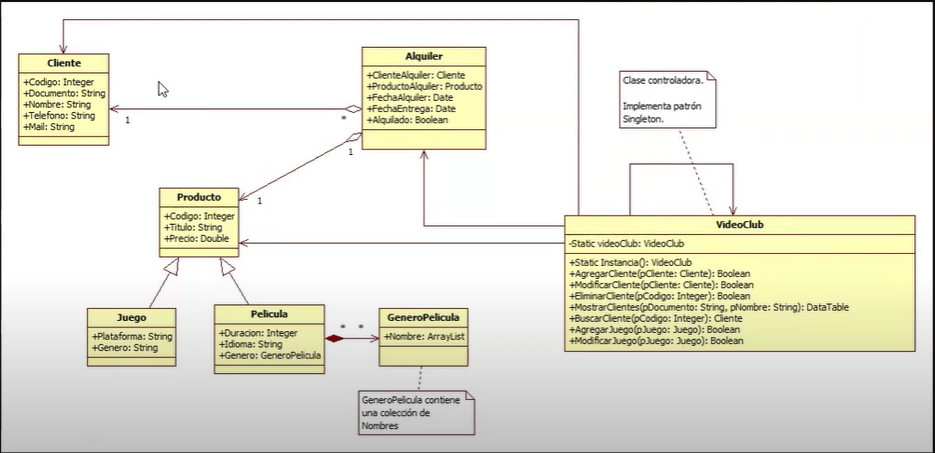

# VideoClub — Java / Spring Boot learning API

**English:** Learning project based on a UML model for customers, products (movies and games), and rentals. The repository implements domain classes, JPA repositories, services, and **two customer-related REST endpoints**.

**Español:** Ejercicio basado en un modelo UML para clientes, productos (películas y juegos) y alquileres. El repositorio incluye entidades, repositorios JPA, servicios y **dos endpoints REST relacionados con clientes**.

## Tech stack

Java 17 · Spring Boot 3.4.3 · Gradle · Spring Web · Spring Data JPA / Hibernate · MySQL · Lombok

## Implemented API / API implementada

| Method | Path | Purpose |
| --- | --- | --- |
| `POST` | `/api/save-cliente` | Create a customer from a `ClienteDTO` |
| `GET` | `/api/get-client?cliente_id=1` | Get a customer by ID |

Example request body for `POST /api/save-cliente`:

```json
{
  "nombre": "Cliente de ejemplo",
  "telefono": "0000000000",
  "email": "cliente@example.com",
  "alquilerIds": []
}
```

The domain includes `Cliente`, `Alquiler`, `Juego`, `Pelicula`, and `Producto`. This is an in-progress exercise: CRUD for all entities, validation, API documentation, and comprehensive tests are **not yet implemented**.

## Local development

1. Install JDK 17 and MySQL.
2. Create a local MySQL database named `videoclub`.
3. Set the `DB_USERNAME` and `DB_PASSWORD` environment variables for that local database. **Never commit real credentials.**
4. Run `./gradlew bootRun` (Windows: `gradlew.bat bootRun`).

> This setup has not been run as part of the documentation review. The application may require additional fixes; the repository is not presented as production-ready.

## Roadmap / Próximos pasos

- Validate request payloads and handle missing customer IDs.
- Complete services and expose rental/product endpoints.
- Add unit and integration tests.
- Add OpenAPI documentation and reproducible example data.

## UML



---

**Portfolio note:** Learning project demonstrating the progression from UML to a layered Java backend.
