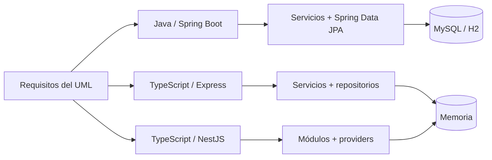

# VideoClub Backend Lab

### Un mismo dominio. Tres implementaciones backend. Decisiones arquitectónicas distintas.

**Java 17 / Spring Boot 3 · TypeScript / Express 5 · TypeScript / NestJS 12**

Este es un **caso de estudio de portafolio y proyecto de aprendizaje**, no un sistema comercial de alquileres. Partimos del UML original de VideoClub para comparar cómo resolver los mismos requisitos con Java/Spring y Node.js/TypeScript. Las tres versiones mantienen repositorios independientes con su historial de commits, pruebas y configuración.

> **Accesos:** [Java Spring Boot](https://github.com/samantonio91/videoclub-api-java) · [Express + TypeScript](https://github.com/samantonio91/videoclub-api-express-ts) · [NestJS + TypeScript](https://github.com/samantonio91/videoclub-api-nestjs-ts) · [UML original](../../images/uml.png) · [UML v2 propuesto](../uml-v2-proposal.md)

## ¿Qué demuestra?

- Arquitectura por capas, controladores, servicios, inyección de dependencias y repositorios.
- Tipado y validación de solicitudes con Jakarta Bean Validation, Zod y DTOs de NestJS.
- Pruebas automatizadas y calidad de código mediante integración continua.
- Evolución del mismo modelo de clientes y videojuegos a sistemas más complejos.

## Estado real de las tres implementaciones

| Implementación | Stack | Funciones terminadas | Almacenamiento |
| --- | --- | --- | --- |
| [Java API](https://github.com/samantonio91/videoclub-api-java) | Spring Boot 3, Spring Data JPA, Java 17 | **7 operaciones del UML** | MySQL en desarrollo / H2 en pruebas |
| [Express API](https://github.com/samantonio91/videoclub-api-express-ts) | Node.js, TypeScript, Express 5 | **7 operaciones del UML** | Memoria (se pierde al reiniciar) |
| [NestJS API](https://github.com/samantonio91/videoclub-api-nestjs-ts) | NestJS 12, TypeScript | **5 operaciones de clientes y health** | Memoria (se pierde al reiniciar) |

**Pendiente:** NestJS aún no incluye las operaciones de juegos; ninguna versión tiene el flujo completo de alquileres y devoluciones con protección ante concurrencia. El [UML v2](../uml-v2-proposal.md) es un diseño **futuro**, no algo ya implementado.

## Comparación de operaciones

| Operación original | Java | Express | NestJS |
| --- | --- | --- | --- |
| Agregar cliente | POST `/api/clientes` | POST `/api/customers` | POST `/api/customers` |
| Modificar cliente | PUT `/api/clientes/{id}` | PUT `/api/customers/:id` | PUT `/api/customers/:id` |
| Eliminar cliente | DELETE `/api/clientes/{id}` | DELETE `/api/customers/:id` | DELETE `/api/customers/:id` |
| Mostrar/filtrar clientes | GET `/api/clientes` | GET `/api/customers` | GET `/api/customers` |
| Buscar cliente | GET `/api/clientes/{id}` | GET `/api/customers/:id` | GET `/api/customers/:id` |
| Agregar juego | POST `/api/juegos` | POST `/api/games` | Pendiente |
| Modificar juego | PUT `/api/juegos/{id}` | PUT `/api/games/:id` | Pendiente |

Las rutas representan operaciones comparables, pero sus contratos JSON y su persistencia no son idénticos.

## Resumen visual

## Calidad y siguientes pasos

Cada repositorio incluye pruebas y tareas específicas en GitHub. Se deben consultar los resultados recientes de CI antes de afirmar que una versión funciona correctamente:

- [CI de Java](https://github.com/samantonio91/videoclub-api-java/actions) · [Roadmap Java](https://github.com/samantonio91/videoclub-api-java/blob/main/ROADMAP.md)
- [CI de Express](https://github.com/samantonio91/videoclub-api-express-ts/actions) · [Roadmap Express](https://github.com/samantonio91/videoclub-api-express-ts/blob/main/ROADMAP.md)
- [CI de NestJS](https://github.com/samantonio91/videoclub-api-nestjs-ts/actions) · [Backlog NestJS](https://github.com/samantonio91/videoclub-api-nestjs-ts/issues)

La fase avanzada de Java propone inventario por copia, alquileres, transacciones, Flyway, Testcontainers, seguridad y control de concurrencia. Son tareas futuras.

**Cómo compartirlo:** utiliza esta página como un **único enlace de VideoClub** en el CV o en tu portafolio, sin presentar las tres implementaciones como proyectos comerciales separados.

[English version](README.md)
