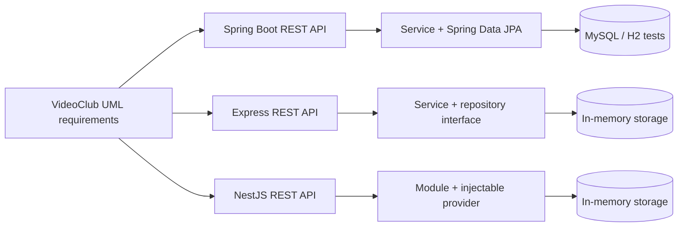

# VideoClub Backend Lab

### One domain. Three backend implementations. Different architectural trade-offs.

**Java 17 / Spring Boot 3 · TypeScript / Express 5 · TypeScript / NestJS 12**

This is a **portfolio case study and learning lab**, not a commercial rental platform. The original VideoClub UML is used to compare how the same backend requirements are implemented across Java/Spring and Node.js/TypeScript. Each version lives in its **own repository** so its dependency choices, CI, tests and development history remain independently reviewable.

> **What to review:** [Spring Boot source](https://github.com/samantonio91/videoclub-api-java) · [Express source](https://github.com/samantonio91/videoclub-api-express-ts) · [NestJS source](https://github.com/samantonio91/videoclub-api-nestjs-ts) · [Original UML](../../images/uml.png) · [Proposed v2 UML](../uml-v2-proposal.md)

## Why this project?

- Compare **dependency injection**, layering and validation across frameworks.
- Model customers, a product hierarchy (`Product → Game/Movie`) and eventually an individually rentable inventory copy.
- Write automated tests and evolve the project via small, reviewed pull requests.
- Distinguish the **seven original UML operations** from a future, richer rental system.

## Implementation status — verified from each README

| Implementation | Framework | Implemented now | Data storage | What it demonstrates |
| --- | --- | --- | --- | --- |
| [Java API](https://github.com/samantonio91/videoclub-api-java) | Java 17, Spring Boot 3, Spring Data JPA | **7 original UML customer/game operations** | MySQL in development; H2 for tests | REST, services, JPA inheritance, request/response DTOs, validation, HTTP error handling |
| [Express API](https://github.com/samantonio91/videoclub-api-express-ts) | TypeScript, Node.js, Express 5 | **7 original UML customer/game operations** | In-memory only | Hand-assembled routes, services and repository interfaces, Zod, Vitest/Supertest |
| [NestJS API](https://github.com/samantonio91/videoclub-api-nestjs-ts) | TypeScript, Node.js, NestJS 12 | **5 customer operations + health** | In-memory only | Nest modules, providers, constructor injection, DTO validation, unit/e2e tests |

**Not yet implemented across these projects:** a complete rental/return lifecycle and concurrency-safe inventory allocation. The [advanced Java UML proposal](../uml-v2-proposal.md) illustrates future work only. NestJS game endpoints are also not yet implemented.

## Shared functional requirements

| Requirement in original UML | Spring Boot route | Express route | NestJS route |
| --- | --- | --- | --- |
| Add customer | `POST /api/clientes` | `POST /api/customers` | `POST /api/customers` |
| Update customer | `PUT /api/clientes/{id}` | `PUT /api/customers/:id` | `PUT /api/customers/:id` |
| Delete customer | `DELETE /api/clientes/{id}` | `DELETE /api/customers/:id` | `DELETE /api/customers/:id` |
| List/filter customers | `GET /api/clientes` | `GET /api/customers` | `GET /api/customers` |
| Find customer | `GET /api/clientes/{id}` | `GET /api/customers/:id` | `GET /api/customers/:id` |
| Add game | `POST /api/juegos` | `POST /api/games` | **Planned** |
| Update game | `PUT /api/juegos/{id}` | `PUT /api/games/:id` | **Planned** |

The endpoints are conceptually comparable, but request/response shapes and persistence strategies are **not identical**. See each repository for its exact API contract. They are independent learning implementations, not interoperable production services.

## Architecture at a glance

## Testing and engineering workflow

Each repository contains its own automated checks; review the latest run status directly rather than assuming that all future changes have passed:

- [Spring Boot CI](https://github.com/samantonio91/videoclub-api-java/actions)
- [Express CI](https://github.com/samantonio91/videoclub-api-express-ts/actions)
- [NestJS CI](https://github.com/samantonio91/videoclub-api-nestjs-ts/actions)

Changes are tracked via feature branches, pull requests and issues. The code has been built with AI-assisted development and human-directed requirements, design review, implementation decisions and CI verification. This case study is **not** evidence of performance, uptime or production scale.

## Next learning milestones

The extended [Java UML v2](../uml-v2-proposal.md) proposes `InventoryCopy`, `Rental` and `Reservation`. Future Spring iterations will explore Flyway, Testcontainers, transactions and concurrency-safe rental operations.

- [Java development backlog](https://github.com/samantonio91/videoclub-api-java/blob/main/ROADMAP.md)
- [Express development backlog](https://github.com/samantonio91/videoclub-api-express-ts/blob/main/ROADMAP.md)
- [NestJS issues](https://github.com/samantonio91/videoclub-api-nestjs-ts/issues)

## Portfolio note

This page is the **single link** to share for the VideoClub comparison. A GitHub profile may show other public repositories; this curated entry point prevents visitors from having to browse them to understand the work. For a professional production case study, see a separately authorized project such as TransVIP rather than portraying this exercise as commercial experience.

[Versión en español](README.es.md)
