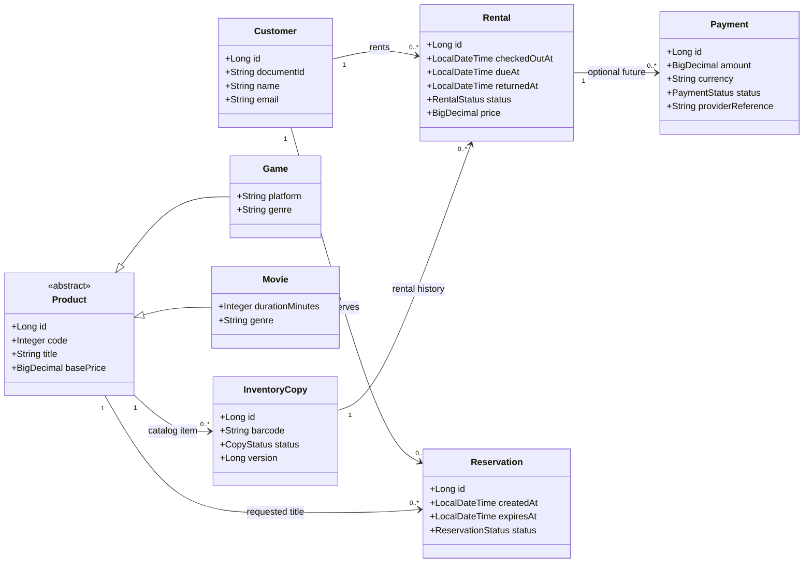
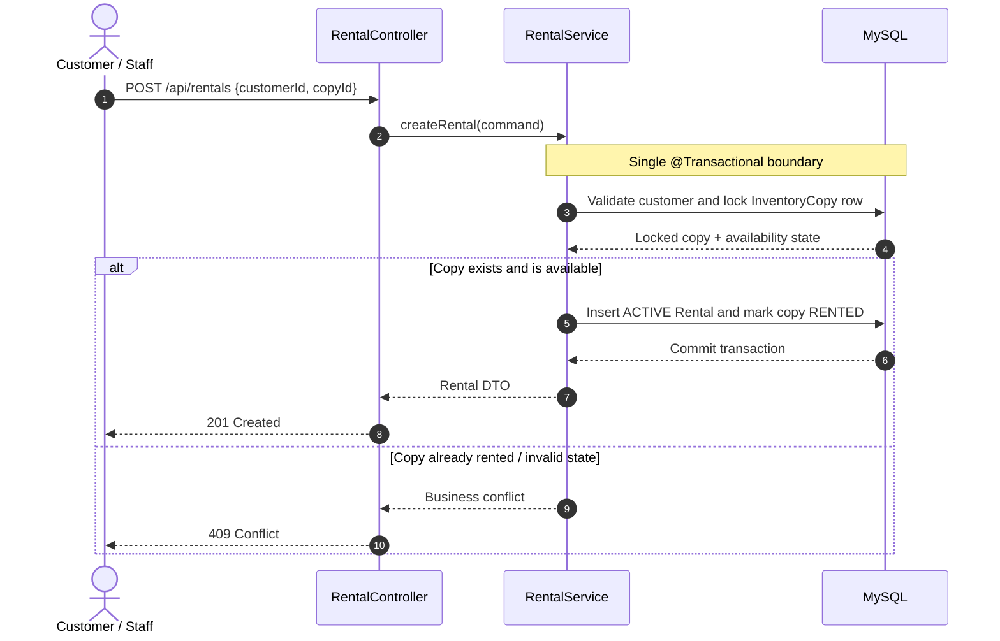
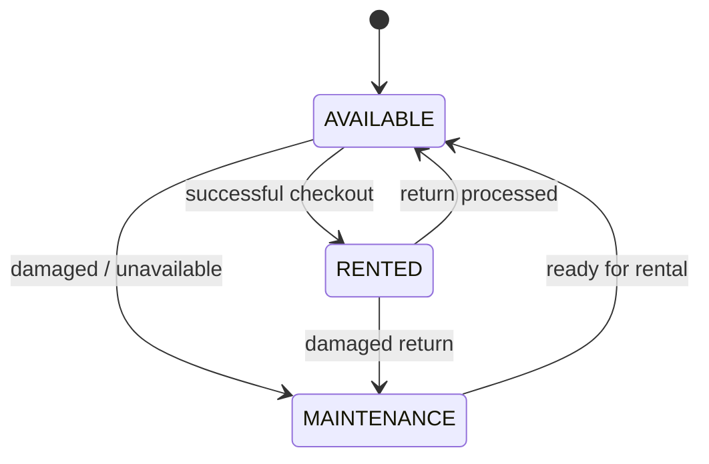

# VideoClub v2 — Proposed UML and domain architecture

> **DRAFT DESIGN / DISEÑO PROPUESTO.** This is **not implemented** in the current Java API. The original UML is preserved at [images/uml.png](../images/uml.png) and the current endpoints remain unchanged.

## Purpose / Propósito

Extend the original **Customer → Product → Rental** model into a realistic catalog/inventory/rental system suitable for demonstrating Spring Boot, Hibernate inheritance, database transactions, optimistic locking, Spring Security, Flyway and integration tests.

The key new concept is **InventoryCopy**: one `Product` may describe a game or movie title, while each physically rentable copy has a unique barcode and independent availability. Historical rentals are kept. A copy can have many past rentals, but at most **one active rental**.

## 1. Proposed domain class diagram

**Legend:** `CopyStatus = AVAILABLE | RENTED | MAINTENANCE`. `RentalStatus = ACTIVE | RETURNED | OVERDUE`. `ReservationStatus = PENDING | FULFILLED | CANCELLED | EXPIRED`. `PaymentStatus = PENDING | PAID | FAILED | REFUNDED` (future optional). Payment is deliberately **optional**, not a current dependency.

**Model details:** `Game` and `Movie` may continue using JPA `InheritanceType.JOINED`, after migration design. Customer and product identifiers must be distinguished from legacy business codes. InventoryCopy may use a JPA `@Version` value but concurrency safety must be proven with real database tests. Reservations may target a product title rather than a specific copy; allocation/hold rules need an explicit design decision before implementation.

## 2. Proposed rental creation sequence

**Concurrency invariant:** two requests attempting to rent the same copy must not both succeed. A row lock (or suitable optimistic concurrency + retry/constraint strategy) is required; a simple check followed by a write is susceptible to races. Verify in [issue #11 Testcontainers](https://github.com/samantonio91/videoclub-api-java/issues/11) and implement in [issue #8 Rentals](https://github.com/samantonio91/videoclub-api-java/issues/8).

## 3. Proposed lifecycle state diagram

The state machine describes an **InventoryCopy**, not a `Rental`. A rental retains its own ACTIVE/RETURNED/OVERDUE lifecycle and historical records.

## 4. Candidate Spring Boot capabilities and where to prove them

| Capability | Real business need | Evidence to build |
| --- | --- | --- |
| Spring MVC + Bean Validation | Reject invalid requests | DTO tests and HTTP contract |
| Spring Data JPA and inheritance | Shared Product / Game / Movie fields | Database migration + JPA integration tests |
| Flyway | Controlled schema upgrades | Fresh DB and migration tests |
| `@Transactional` + locking | Prevent double rental | Parallel HTTP/DB tests on MySQL |
| Spring Security | Customer/staff permissions | 401/403 and ownership tests |
| Testcontainers | Reproduce DB behavior | CI integration test logs |
| Spring Actuator / Micrometer | Operability | Safe health and meaningful metrics |
| OpenAPI | Discoverable APIs | Generated spec for *actual* endpoints |
| Application events/outbox | Future notifications | Design spike only, if justified |

## 5. Non-goals and boundary

- This diagram **does not document currently shipped functionality**.
- No real payments or notification provider is required for the first rental milestone.
- No production metrics, commercial users, or live payments are claimed.
- API route renaming and SQL schema migration require separate compatibility review.
- Keep sample data synthetic, never include customers' actual personal details.

**Implementation order:** [ROADMAP.md](../ROADMAP.md) → [#4 validations](https://github.com/samantonio91/videoclub-api-java/issues/4) → [#5 migrations](https://github.com/samantonio91/videoclub-api-java/issues/5) → [#11 integration tests](https://github.com/samantonio91/videoclub-api-java/issues/11) → [#7 inventory](https://github.com/samantonio91/videoclub-api-java/issues/7) → [#8 rentals](https://github.com/samantonio91/videoclub-api-java/issues/8).
